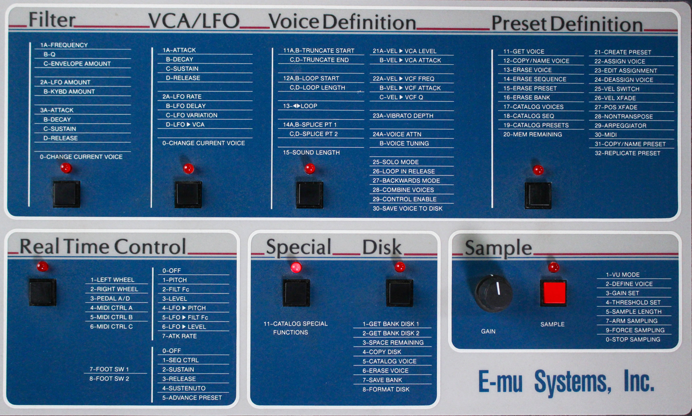

[](LICENSE)

[](README.md)
[](README_HU.md)

> **1984 hardware. Eight voices. Digital grit. Analog character.**

**Emu II 1984** is an independent, open-source research project exploring a **firmware-assisted, hardware-oriented software emulation** of the 1984 **E-mu Emulator II** sampling keyboard, with a long-term goal of running as an instrument plug-in in modern DAWs.

Inspired by early industrial synth-pop and the stark atmosphere of George Orwell's *Nineteen Eighty-Four*, the project aims to preserve the restrictions, artifacts, and distinctive character of the original instrument—not simply imitate its presets with an ordinary sample player.

> [!IMPORTANT]
> **Project status: research and architecture stage.** This repository description is a development proposal, **not a claim of a functioning Emulator II emulation**. No working firmware boot, audio engine, plug-in binary, or release is implied by the roadmap below.

## Vision

The priority is **authentic behavior where technically feasible**:

- Run compatible original **main and scanner firmware** on two emulated **Z80 CPUs** (nominally 4 MHz each).
- Reconstruct the **boot sequence, memory banking, peripheral I/O, disk subsystem, and control behavior**.
- Recreate **eight-voice sample playback**, the original **8-bit companded audio path**, clocking, and DAC characteristics.
- Model the **SSM2045 analog filter/VCA signal path**, envelopes, and modulation with measured or circuit-informed DSP.
- Support vintage disks and bank files without requiring the user to convert everything into modern multisample formats.
- Eventually wrap the engine as **VST3** (Windows/macOS), **AU** (macOS), and possibly **CLAP**, with a modern interface inspired by the original hardware.

**Design principle:** original firmware controls emulated hardware; any unavailable or undocumented hardware logic must be reconstructed as an explicit, testable model. Running a Z80 ROM alone will not produce sound.

## Hardware reference



*Detail of the original E-mu Emulator II control panel.*

## Proposed architecture

```text
DAW MIDI / automation
        |
        v
Host adapter (VST3 / AU / optional CLAP) + user interface
        |
        v
Deterministic hardware scheduler and event bridge
        |
   +----+--------------------+
   |                         |
   v                         v
Main Z80 (4 MHz)        Scanner Z80 (4 MHz)
ROM, RAM, I/O, DMA       Keys, controls, I/O
   |                         |
   +--------+----------------+
            |
            v
Disk controller / system OS / memory banking
            |
            v
Eight-voice sample engine + companding + DAC model
            |
            v
SSM2045-style filter / VCA / analog output model
            |
            v
Host-rate audio output
```

The **real-time audio callback must not perform blocking disk I/O or allocations**. Hardware emulation, event scheduling, resampling, state restore, and latency behavior require dedicated validation before a plug-in release.

## Firmware, disks, and the missing hardware

The Emulator II has **separate embedded firmware and disk-loaded system software**. The design must distinguish:

1. **Main CPU boot ROM** and **scanner CPU ROM** (version pairing must be verified).
2. **OS/system floppy image**, loaded through the emulated disk subsystem.
3. **Sound banks and samples**, loaded from compatible disk or bank files.
4. **Sound-engine control logic**, including programmable logic/microcode that is not yet fully recovered in public reference implementations.

The [MAME Emulator II skeleton driver](https://github.com/mamedev/mame/blob/master/src/mame/emusys/emu2.cpp) documents two Z80s and several devices but is currently marked **`MACHINE_NOT_WORKING | MACHINE_NO_SOUND`**. Two programmable logic dumps (`74s472.ic135` and `74s472.ic137`) are marked **`NO_DUMP`**. It is an important research reference, **not a ready-to-use audio emulation core**.

### Candidate file formats

| Format | Intended use | Notes |
| --- | --- | --- |
| `.img` | Emulator II floppy image | Planned research / import |
| `.emuiifd` | Emulator II floppy image | Planned research / import |
| `.hfe` | Floppy emulator image | Planned research / import |
| `.eii` | Extracted Emulator II bank data | **Bank format, not the same thing as a complete bootable floppy image** |

The format distinctions above follow research published in [ConvertWithMoss](https://github.com/git-moss/ConvertWithMoss) 20.3.0. Actual compatibility, write support, and firmware version coverage remain **to be implemented and tested** here.

## Roadmap

All milestones are **planned**, not completed.

| Milestone | Workstream | Acceptance criteria |
| --- | --- | --- |
| **M0** | Hardware documentation and legal dependency review | ROM/OS inventory, memory map, device list, provenance and licensing matrix |
| **M1** | Dual-Z80 foundation | Deterministic CPU and peripheral tests; main/scanner ROM startup traces |
| **M2** | Floppy, RAM and OS boot | Load a properly supplied OS image and reach a reproducible UI/OS state |
| **M3** | Digital voice engine | Eight voices, correct companding/DAC behavior, loop and pitch tests |
| **M4** | Analog audio model | Filter/VCA/modulation tests against schematics and reference recordings |
| **M5** | Plugin integration | VST3/AU prototypes, MIDI, preset state, offline render, no audio-thread blocking |
| **M6** | Validation and releases | Cross-platform CI, regression audio tests, documentation and reproducible builds |

**First engineering target:** establish an auditable, reproducible boot path rather than announcing an audio plug-in before the original system behavior is understood.

## Research references

- **[MAME — Emulator II driver](https://github.com/mamedev/mame/blob/master/src/mame/emusys/emu2.cpp):** hardware map and starting-point device research; the file identifies itself as `BSD-3-Clause`. Other MAME components may carry different licences.
- **[kosarev/z80](https://github.com/kosarev/z80):** MIT-licensed C++ Z80 core under evaluation in the synthetic tests.
- **[ConvertWithMoss](https://github.com/git-moss/ConvertWithMoss):** LGPL-3.0 sampler format research, including Emulator II disk/bank parsing; **not integrated**.
- **[JUCE](https://github.com/juce-framework/JUCE):** candidate plug-in framework, available under **AGPLv3 or a commercial licence**; **not integrated**.
- **[Steinberg VST3 SDK](https://github.com/steinbergmedia/vst3sdk):** modern SDK releases use the **MIT licence**; **not integrated**.

See [THIRD_PARTY_NOTICES.md](THIRD_PARTY_NOTICES.md) before adopting external code. Linking to a research project does not mean its sources are included in this repository.

## Getting started

Follow the [build and test instructions](docs/BUILD.md) to compile the research core and run the synthetic tests. Installable plug-ins are planned for milestones M5–M6.

**Do not commit or redistribute original ROM, operating-system disk images, factory libraries, or third-party sound banks** without an appropriate legal right to do so. ROM and sample data are **not covered by this project's code licence**.

## Contributing

Contributions relating to Z80 timing, circuit diagrams, disk formats, programmable logic, companding/DAC tests, and SSM2045 modeling are welcome.

- Open an **Issue** for confirmed observations, reproducible experiments, or proposed architecture.
- Use **Pull Requests** for independently licensed, reviewable code or documentation.
- Identify any third-party source, copyright holders, licences, and test materials. Do not upload copyrighted firmware or sample libraries.
- Prefer clear tests, reproducible evidence, and separation of firmware emulation from the real-time audio callback.

## Licence and legal notice

**Project-authored code and documentation:** **[GNU Affero General Public License v3.0 only (AGPL-3.0-only)](LICENSE)**, unless a file states otherwise. The licence allows commercial use and redistribution **subject to its terms**; “non-commercial only” is **not** a restriction imposed by this project licence.

- **JUCE:** if its AGPLv3 option is used, distribution of the combined work must meet applicable AGPL obligations; a separate commercial JUCE licence is a different option and does **not** automatically relicense this project's AGPL code.
- **Third-party components:** retain their own copyright and licence notices. A suitable licence must be checked **before** code is imported.
- **Firmware, system disks, factory presets, and audio samples:** are excluded from the project licence and must not be assumed freely redistributable.
- **Trademarks:** E-mu and Emulator II are mentioned to identify the historic instrument. This project is **independent, unofficial, and not endorsed by or affiliated with the trademark owners**.

This is a research and preservation-oriented project, without warranty. Copyright and trademark questions may vary by jurisdiction; this README is not legal advice.

---

*Emu II 1984 — preserving the limitations that made a landmark sampler sound unlike anything else.*

## Development baseline

[Build and tests](docs/BUILD.md) · [Current roadmap](docs/ROADMAP.md) · [Hardware map](docs/HARDWARE_MAP.md) · [Source audit](docs/SOURCE_AUDIT.md)

M0 includes scanner memory, filename/size format hints, and a test-only [dual-Z80 instruction probe](docs/CPU_DECISION.md). Firmware boot, audio, and plug-ins remain future milestones.
